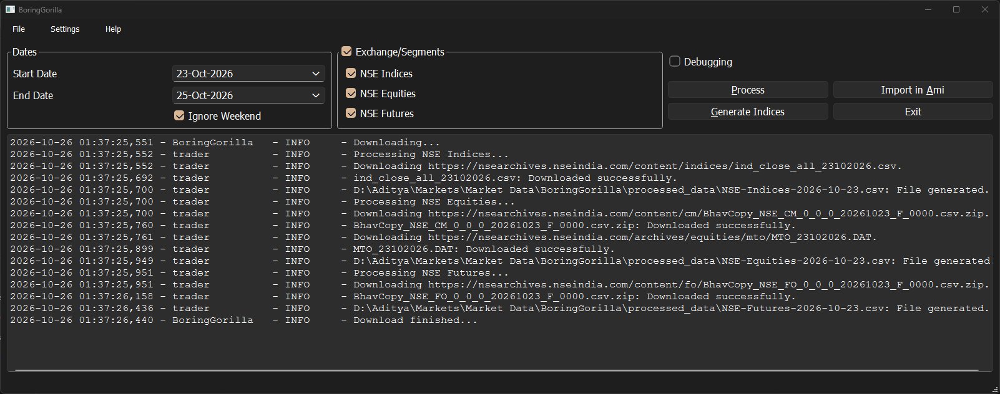

# BoringGorilla

A Python desktop application for downloading and processing NSE market data, with support for indices, equities, futures, and AmiBroker workflows.

# Features

- Download and process NSE market data.
- Support for indices, equities, and futures.
- Configure date ranges and output locations.
- Integrate with AmiBroker.

# Tech Stack

- Python 3
- PyQt6

# Development

`dev.py` has useful utilities to auto-generate design files, build executables, clean workspace, etc. Run it to view all the commands and options available:

    python3 dev.py

# License

GPL-3.0-or-later
